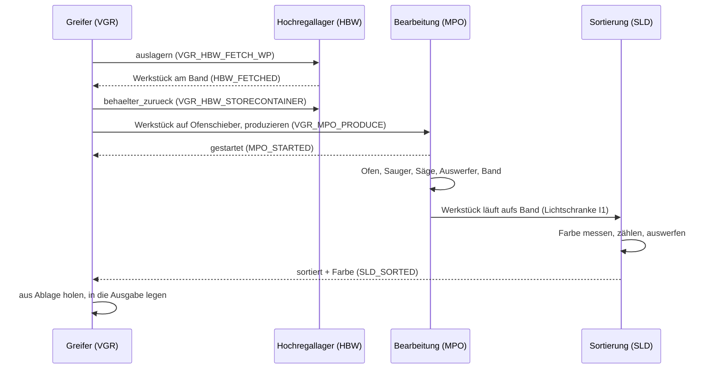
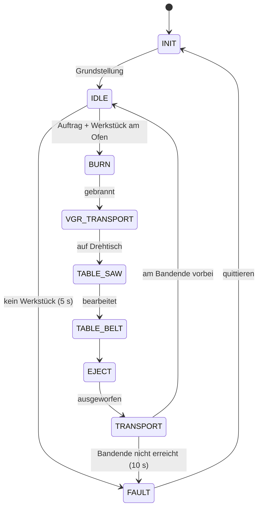
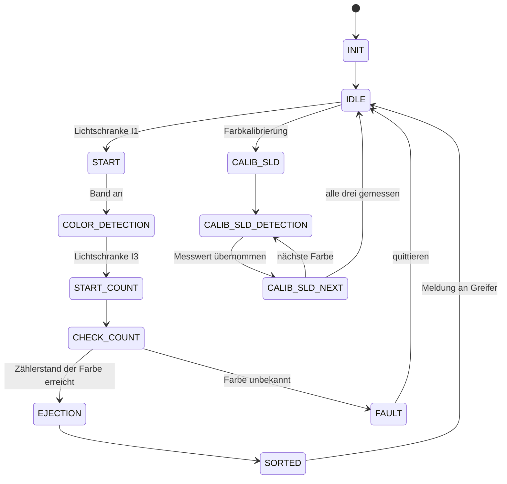
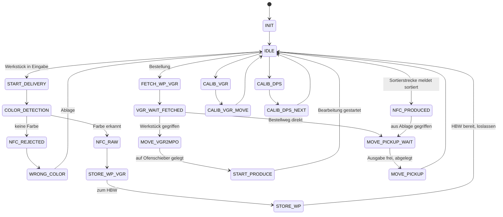
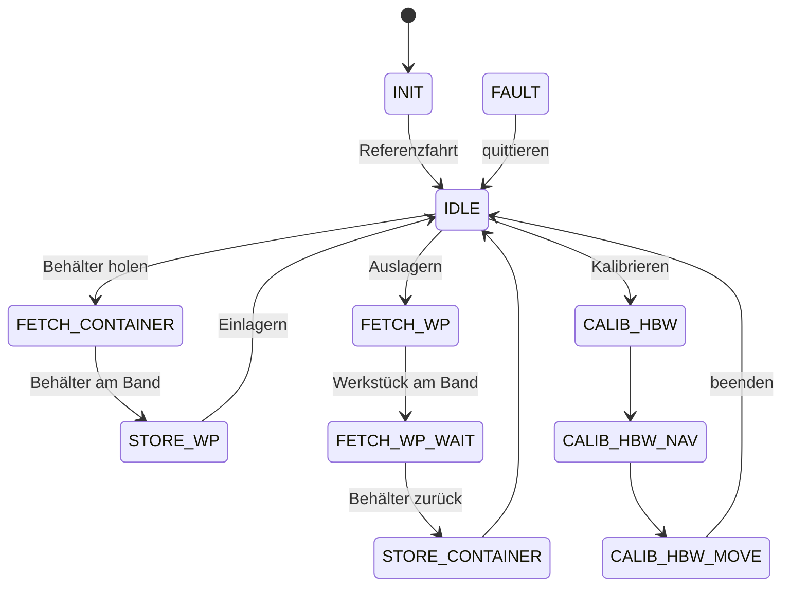

# Lernfabrik 4.0 – Greifer-Gruppe (Viola, Laurens)

> **Repo der Greifer-Gruppe** im Modul Fördertechnik. Unser Schwerpunkt ist der Vakuum-Sauggreifer mit Ein-/Ausgabestation. Unser Leitfaden dazu: **[docs/GREIFER.md](docs/GREIFER.md)**.
> Das Repo enthält das komplette lauffähige Programm für die ganze Fabrik. Es baut auf [Hochregallager-und-Dashboard](https://github.com/VSO-WIG-SO26-27/Hochregallager-und-Dashboard) auf; die Historie ist übernommen.

## Lernfabrik 4.0 – Python-Steuerung und Dashboard

Python-Steuerung für die fischertechnik Lernfabrik 4.0 mit Dashboard im Browser. Unterstützt werden vier Stationen:

| Station | Kürzel im Original | TXT | Python-Datei |
|---|---|---|---|
| **Hochregallager** | HBW (High-Bay Warehouse) | 192.168.0.12 | `lernfabrik/steuerung.py` |
| **Vakuum-Sauggreifer mit Ein-/Ausgabestation** | VGR / DPS | 192.168.0.13 | `lernfabrik/greifer.py` |
| **Bearbeitungsstation mit Ofen und Säge** | MPO (Multi-Processing Station with Oven) | 192.168.0.11 + Erweiterungs-TXT | `lernfabrik/ofen.py` |
| **Sortierstrecke mit Farberkennung** | SLD (Sorting Line with Color Detection) | 192.168.0.14 | `lernfabrik/sortierung.py` |

Die Logik ist 1:1 aus dem Original-C++-Code übernommen ([fischertechnik/txt_training_factory](https://github.com/fischertechnik/txt_training_factory), `TxtSmartFactoryLib`).
Ein Rechner steuert alle TXT-Controller per WLAN über [ftrobopy](https://github.com/ftrobopy/ftrobopy). Auf den TXT läuft dabei kein eigenes Programm.

```
py start.py --sim                   # ohne Anlage (Simulation aller vier Stationen)
py start.py                         # an der Anlage: alle vier Stationen
py start.py --stationen hbw,vgr     # nur Hochregallager + Greifer
py start.py --nur-hbw               # nur das Hochregallager
```
(Unter macOS/Linux `python3` statt `py`.) Das Dashboard öffnet sich automatisch unter http://127.0.0.1:8000.

---

## 1. Vorbereitung (einmalig)

1. **Python-Paket installieren:** `py -m pip install ftrobopy`
   (`paho-mqtt` brauchst du nur für `--mqtt`, `pytest` nur für die automatischen Tests.)
2. **Netzwerk:** Den Rechner mit dem WLAN des Lernfabrik-Routers verbinden.
   Prüfen mit `ping 192.168.0.11` … `ping 192.168.0.14`.
   Andere IPs gibst du mit `--ip`, `--ip-greifer`, `--ip-mpo`, `--ip-sld` an oder trägst sie in `lernfabrik/konfiguration.py` ein.
3. **Original-Programme stoppen:** Auf **allen** benutzten TXT das laufende Programm (`TxtFactoryHBW`, `TxtFactoryVGR`, `TxtFactoryMPO`, `TxtFactorySLD`) beenden und *Einstellungen → Autoload* ausschalten. Danach die TXT neu starten.
4. **Kalibrierwerte (optional):** Die Original-Dateien vom TXT funktionieren im selben Format.
   Lege sie dafür in den Ordner `daten/`:

   | Original auf dem TXT | Datei in `daten/` |
   |---|---|
   | `Data/Calib.HBW.json` | `kalibrierung.json` |
   | `Data/Calib.VGR.json` | `kalibrierung_greifer.json` |
   | `Data/Calib.DPS.json` | `kalibrierung_farbsensor.json` |
   | `Data/Calib.SLD.json` | `kalibrierung_sortierung.json` |

## 2. Hardwaretest – vor dem ersten Start

```
py hardwaretest.py                       # Hochregallager
py hardwaretest.py --station greifer     # Greifer + Ein-/Ausgabe
py hardwaretest.py --station ofen        # Bearbeitungsstation (Master + Erweiterung)
py hardwaretest.py --station sortierung  # Sortierstrecke
py hardwaretest.py --sim --station ofen  # Menü in der Simulation ausprobieren
```

| Greifer-Anschluss | Funktion | erwarteter Wert |
|---|---|---|
| I1 / I2 / I3 | Referenztaster Drehung / Höhe / Arm | 1 = gedrückt |
| M1+C1 / M2+C2 / M3+C3 | Motor + Encoder Drehung / Höhe / Arm | Position ≈ 100 nach Test |
| O7 / O8 | Kompressor / Ventil | Sauger saugt an |
| I7 | Lichtschranke Eingabe | **0** = Werkstück liegt drin |
| I8 | Farbsensor (analog) | weiß < rot < blau (mV) |
| C4 | Lichtschranke Ausgabe | **1** = frei |

Beim Greifer immer **zuerst die Höhe** (Test 2) referenzieren, damit der Arm oben ist, bevor er sich dreht.
Fährt etwas in die falsche Richtung, sofort **Strg+C** drücken.

**Bearbeitungsstation:** Zuerst Test 1 (Eingänge live) und den Ofenschieber von Hand verschieben. C++-Code und Hersteller-Pinliste widersprechen sich, welcher Taster (Erweiterung I1 oder I2) „außen“ bedeutet. Der Code folgt dem C++-Code. Stimmt es nicht, in `konfiguration.py` bei `MPO_SCHIEBER_TASTER` tauschen. Vor „Schieber rein“ muss die Ofentür offen sein.

**Sortierstrecke:** Test 2 prüft den Bandzähler C1. Das Original zählt Flanken (jede Zustandsänderung), der TXT-Zähler zählt Impulse. Der Faktor `SLD_FLANKEN_PRO_IMPULS = 2` rechnet um. Landen die Werkstücke an der Anlage vor dem falschen Auswerfer, diesen Faktor oder die Zählerstände in `daten/kalibrierung_sortierung.json` anpassen.

## 3. Bedienung im Dashboard

Der Reiter **Übersicht** zeigt oben alle Stationen auf einen Blick (in der Simulation auch, wo die Werkstücke gerade liegen). Ein Klick auf eine Karte öffnet den Reiter der Station.

- **Einlagern:** Werkstück in die Eingabe legen. Der Greifer erkennt es (Lichtschranke I7), saugt es an, fährt zum Farbsensor und bestimmt die Farbe. In der Zwischenzeit stellt das Hochregallager einen leeren Behälter aufs Band. Der Greifer legt das Werkstück hinein, danach lagert das Hochregallager den Behälter ein.
  Wird keine Farbe erkannt, landet das Werkstück in der Ablage für falsche Werkstücke.
  Die automatische Annahme lässt sich abschalten. Dann startest du den Vorgang mit *Jetzt annehmen*.
- **Bestellen:** Farbe wählen. Wie im Original läuft das Werkstück so:
  1. Das Hochregallager lagert den Behälter aus, der Greifer nimmt das Werkstück heraus, der leere Behälter geht zurück ins Regal.
  2. Der Greifer legt das Werkstück auf den Ofenschieber der **Bearbeitungsstation**: Ofen („brennen“), interner Sauger setzt es auf den Drehtisch, Säge, Auswerfer aufs Band.
  3. Die **Sortierstrecke** misst die Farbe und schiebt das Werkstück in die Ablage seiner Farbe.
  4. Der Greifer holt es dort ab und legt es in die Ausgabe. Ist die Ausgabe belegt (C4), wartet er.

  Mit dem Schalter **Bestellweg → direkt zur Ausgabe** werden Bearbeitung und Sortierung übersprungen. Das ist auch der Fall, wenn diese Stationen nicht laufen.
- **NOT-HALT** stoppt alle Stationen. *Alle Fehler quittieren* setzt jede Station im Fehlerzustand zurück.
- **Bestellung abbrechen** gibt es für den Fall, dass ein Werkstück unterwegs verloren geht und der Greifer sonst keine neue Bestellung annimmt.

Weitere Reiter:
- **Hochregallager:** Handsteuerung, Kalibrierung und Handbetrieb des Regals. Solange der Greifer gerade mit dem Hochregallager arbeitet, sind diese Knöpfe gesperrt.
- **Greifer:** Achspositionen, Eingänge, Handbetrieb, Positionen kalibrieren (Punkt wählen, mit ±-Knöpfen justieren, *Position speichern*; die Anfahrpunkte „…0“ werden wie im Original mit angepasst), Farbsensor kalibrieren (weiß, rot, blau nacheinander messen).
- **Ofen & Säge:** Zustand von Drehtisch, Sauger, Ofenschieber, alle Ein- und Ausgänge (Master und Erweiterung), *Bearbeitung starten* (wenn von Hand ein Werkstück auf dem Ofenschieber liegt), *Grundstellung* und Handbetrieb jedes Aktors.
- **Sortierung:** Farbsensor live, letzte erkannte Farbe, Bandimpulse, Belegung der drei Ablagen, Handbetrieb (Band, Auswerfer) und **Farbkalibrierung** (Band läuft; weiß, rot, blau nacheinander auflegen, die Schwellwerte werden wie im Original berechnet).

In der Simulation (`--sim`) gibt es zusätzlich Knöpfe, mit denen man Werkstücke in die Eingabe, auf den Ofenschieber oder auf die Sortierstrecke legen und die Ausgabe leeren kann.

## 4. Aufbau des Codes

| Python | entspricht im C++-Original | Inhalt |
|---|---|---|
| `lernfabrik/konfiguration.py` | Konstruktoren, `PinAssignmentTXT.md`, `saveDefault()` | IPs, Pin-Belegung, Zeiten, Standardpositionen aller Stationen |
| `lernfabrik/hardware.py` | Transferbereich `FISH_X1_TRANSFER` | Motoren/Ausgänge/Zähler/Eingänge über ftrobopy (auch Erweiterungs-TXT) + Grundgerüst der Simulation |
| `lernfabrik/simulation.py` | – (neu) | Simulation der Werkstücke über alle Stationen (`SimWelt`) und der einzelnen Stationen |
| `lernfabrik/achsen.py` | `TxtAxis1RefSwitch`, `TxtAxisNSwitch`, `TxtConveyorBelt` | Referenzfahrt, Positionieren, Achsen mit 2 oder 3 Tastern, Förderbänder |
| `lernfabrik/station.py` | `TxtSimulationModel` | gemeinsame Grundlage: Status, Not-Halt, Hauptschleife |
| `lernfabrik/steuerung.py` | `TxtHighBayWarehouse*.cpp` | Hochregallager: Abläufe + Zustandsautomat |
| `lernfabrik/greifer.py` | `TxtVacuumGripperRobot*.cpp`, `TxtVacuumGripper`, `TxtDeliveryPickupStation` | Greifer + Ein-/Ausgabe: Abläufe + Zustandsautomat |
| `lernfabrik/ofen.py` | `TxtMultiProcessingStation*.cpp` | Bearbeitungsstation: Ofen, Sauger, Drehtisch, Säge, Band |
| `lernfabrik/sortierung.py` | `TxtSortingLine*.cpp` | Sortierstrecke: Farberkennung, Zählen, Auswerfen |
| `lernfabrik/daten.py` | `…CalibData`, `…Storage` | Lager, Kalibrierungen (Original-JSON-Format) |
| `lernfabrik/mqtt_bruecke.py` | `TxtMqttFactoryClient` | optional: HBW mit Original-Greifer per MQTT |
| `lernfabrik/dashboard.py/.html` | – (neu) | Dashboard |
| `tests/test_ablaeufe.py` | – (neu) | automatische Tests aller Abläufe in der Simulation |

Der Ordner hieß früher `code/`. Er wurde umbenannt, weil `code` auch ein eingebautes Python-Modul ist. Diese Doppelung hat pytest (ab Python 3.13) und den Debugger gestört.

### Zusammenspiel der Stationen

Im Original sprechen die Stationen über MQTT miteinander (`fl/vgr/do`, `fl/hbw/ack`, `fl/mpo/ack`, `fl/sld/ack`). Hier laufen alle im selben Programm. Der Greifer ist der Auftraggeber und ruft dieselben Befehle direkt bei den anderen Stationen auf:



### Zustandsautomat Bearbeitungsstation (aus `TxtMultiProcessingStationRun.cpp`)



### Zustandsautomat Sortierstrecke (aus `TxtSortingLineRun.cpp`)



### Zustandsautomat Greifer (aus `TxtVacuumGripperRobotRun.cpp`)



### Zustandsautomat Hochregallager (aus `TxtHighBayWarehouseRun.cpp`)



## 5. Automatische Tests

```
py -m pip install pytest
py -m pytest
```
Die Tests laufen komplett in der Simulation (ca. 1–2 Minuten). Sie prüfen den kompletten Bestellweg über alle Stationen, den direkten Bestellweg, unbekannte Farben, belegte Ausgabe, die Sortierstrecke allein, Fehler und Quittieren an der Bearbeitungsstation und den Not-Halt. Nach jeder Änderung am Code einmal laufen lassen.

## 6. Unterschiede zum Original

- **Kein NFC:** Die NFC-Position wird wie im Original angefahren, gelesen oder beschrieben wird aber nichts. Jedes Werkstück bekommt stattdessen eine erzeugte ID.
- **Bestellweg „direkt“:** zusätzlich wählbar (Hochregallager → Ausgabe, ohne Bearbeitung und Sortierung).
- **Fehlerbehandlung:** Statt `exit(1)` gehen die Stationen in den Zustand FAULT und lassen sich quittieren. Meldet eine Station während einer Übergabe einen Fehler, bricht auch der Greifer ab, statt endlos zu warten.
- **Bearbeitungsstation:** Zeitüberschreitungen führen wirklich in FAULT (im C++-Code wurde der Übergang sofort überschrieben). Bei Fehlern werden Motoren, Kompressor, Auswerfer und Licht abgeschaltet; nach dem Quittieren fährt die Station in die Grundstellung.
- **Sortierstrecke:** Zeitüberschreitungen beim Messen und Zählen führen in FAULT (Original: endloses Warten). Der Kompressor wird nach dem Sortieren abgeschaltet. Ob das Werkstück in der Ablage ankommt, wird geprüft und als Hinweis gemeldet (im Original auskommentiert).
- **Eingabe-Entprellung:** Ein Werkstück wird erst angenommen, wenn die Lichtschranke 0,5 s belegt ist. Außerdem muss das Hochregallager bereit sein und einen leeren Behälter haben.
- **Bedienung:** Dashboard statt Joystick und NFC-Befehlskarten. Not-Halt und Handbetrieb sind neu. Töne werden nicht abgespielt.

## 7. Bitte an der Anlage prüfen

- Die Standardpositionen des Greifers stammen aus dem Original. Vor dem ersten Automatiklauf die Punkte **Eingabe, Farbsensor, Ablage, Ausgabe, Hochregallager, Bearbeitungsstation und die drei Sortier-Ablagen** im Dashboard anfahren und bei Bedarf nachkalibrieren.
- Den Farbsensor des Greifers **und** den der Sortierstrecke einmal mit euren Werkstücken kalibrieren. Licht und Abstand beeinflussen die Messwerte.
- **Bearbeitungsstation:** Belegung des Ofenschiebers (siehe Abschnitt 2). ftrobopy muss den Erweiterungs-TXT ansprechen können (`use_extension`); das ist an der echten Anlage noch nicht getestet.
- **Sortierstrecke:** Zählfaktor und Auswurfpositionen (siehe Abschnitt 2).
- Die Tastersignale kommen per WLAN mit etwa 10–50 ms Verzögerung an. Fährt eine Achse spürbar über den Taster hinaus, `GESCHWINDIGKEIT` in `konfiguration.py` senken.
