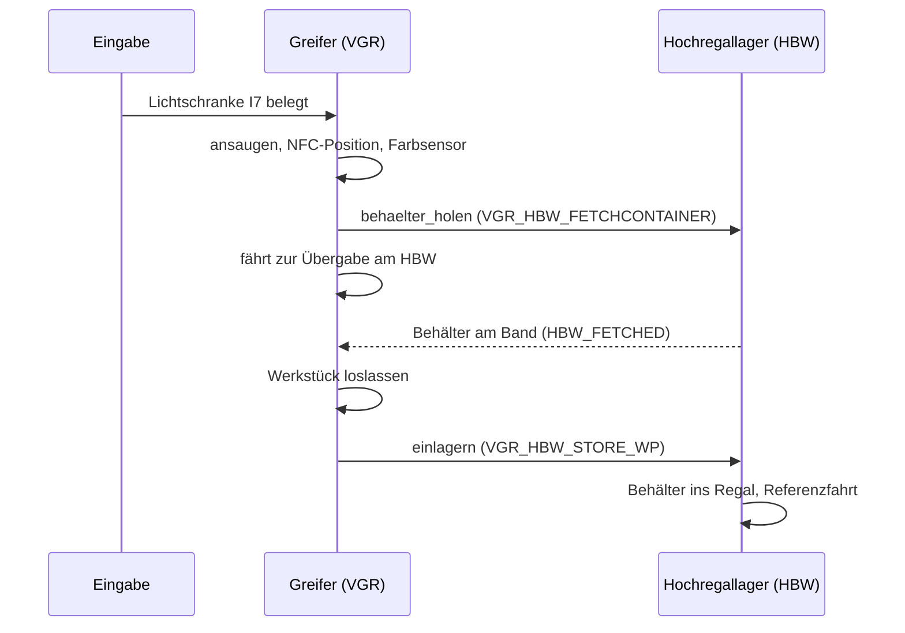
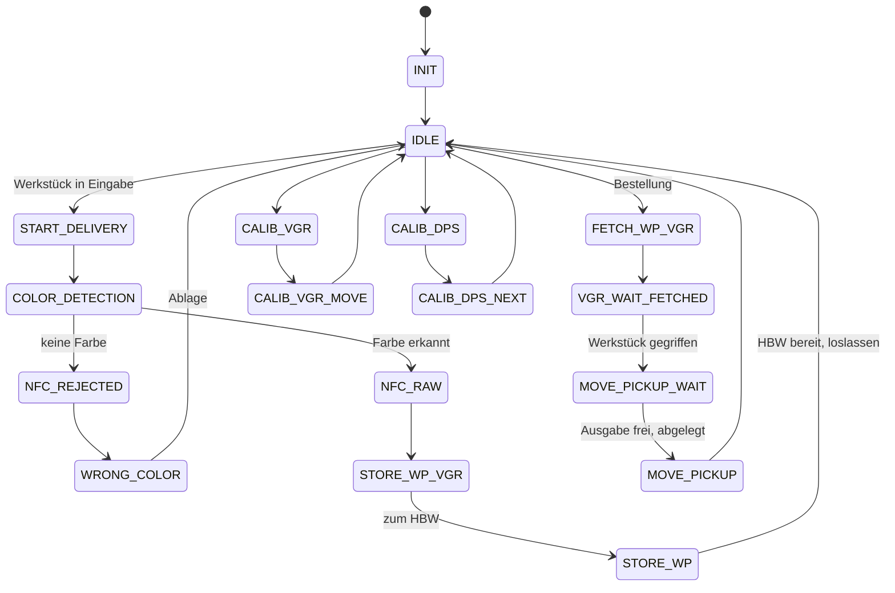
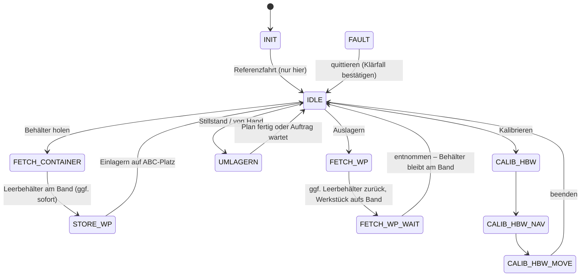

# Hochregallager und Dashboard

Python-Steuerung für die fischertechnik Lernfabrik 4.0 mit Dashboard im Browser. Unterstützt werden zwei Stationen:

- **Hochregallager (HBW)**, TXT 192.168.0.12
- **Vakuum-Sauggreifer mit Ein-/Ausgabestation (VGR/DPS)**, TXT 192.168.0.13

Die Logik ist 1:1 aus dem Original-C++-Code übernommen ([fischertechnik/txt_training_factory](https://github.com/fischertechnik/txt_training_factory), `TxtSmartFactoryLib`).
Der Mac steuert beide TXT-Controller per WLAN über [ftrobopy](https://github.com/ftrobopy/ftrobopy).

```
d "Greifer und HRL"
python3 start.py              # Hochregallager + Greifer
python3 start.py --nur-hbw    # nur das Hochregallager
python3 start.py --sim        # ohne Anlage (Simulation)
```

Das Dashboard öffnet sich automatisch unter http://127.0.0.1:8000.

---

## 1. Vorbereitung (einmalig)

1. **Python-Paket installieren:** `pip3 install ftrobopy`
   (`paho-mqtt` brauchst du nur für `--mqtt`.)
2. **Netzwerk:** Den Mac mit dem WLAN des Lernfabrik-Routers verbinden.
   Prüfen mit `ping 192.168.0.12` (Hochregallager) und `ping 192.168.0.13` (Greifer).
   Andere IPs gibst du mit `--ip` bzw. `--ip-greifer` an oder trägst sie in `code/konfiguration.py` ein.
3. **Original-Programme stoppen:** Auf **beiden** TXT das laufende Programm (`TxtFactoryHBW` bzw. `TxtFactoryVGR`) beenden und *Einstellungen → Autoload* ausschalten. Danach die TXT neu starten.
4. **Kalibrierwerte (optional):** Die Original-Dateien vom TXT funktionieren im selben Format.
   Lege sie dafür in den Ordner `daten/`:

   | Original auf dem TXT | Datei in `daten/` |
   |---|---|
   | `Data/Calib.HBW.json` | `kalibrierung.json` |
   | `Data/Calib.VGR.json` | `kalibrierung_greifer.json` |
   | `Data/Calib.DPS.json` | `kalibrierung_farbsensor.json` |

## 2. Hardwaretest – vor dem ersten Start

```
python3 hardwaretest.py                    # Hochregallager
python3 hardwaretest.py --station greifer  # Greifer + Ein-/Ausgabe
```

| Greifer-Anschluss | Funktion | erwarteter Wert |
|---|---|---|
| I1 / I2 / I3 | Referenztaster Drehung / Höhe / Arm | 1 = gedrückt |
| M1+C1 / M2+C2 / M3+C3 | Motor + Encoder Drehung / Höhe / Arm | Position ≈ 100 nach Test |
| O7 / O8 | Kompressor / Ventil | Sauger saugt an |
| I7 | Lichtschranke Eingabe | **0** = Werkstück liegt drin |
| I8 | Farbsensor (analog) | weiß < rot < blau (mV) |
| C4 | Lichtschranke Ausgabe | **1** = frei |

Beim Greifer immer **zuerst die Höhe** (Test 2) referenzieren, damit der Arm oben ist, bevor er sich dreht.
Fährt etwas in die falsche Richtung, sofort **Strg+C** drücken.

## 3. Bedienung im Dashboard (Lagerleitstand)

Das Dashboard ist wie eine Industrie-HMI aufgebaut: Kopfzeile mit Anlagenzustand, **Kennzahlen**-Knopf und **NOT-HALT**, darunter eine Alarmleiste für Störungen und Klärfälle.

| Reiter | Inhalt |
|---|---|
| **Leitstand** | Kennzahl-Kacheln, Frontansicht des Regals (Platzzustand, ABC-Zone, Reservierungen, Position des Regalbediengeräts, Förderstrecke), Auslagerauftrag anlegen, **Warteschlange**, zuletzt erledigte Aufträge, Greifer & Übergabe, Ereignisse |
| **Lager & Umlagerung** | Lagerplatz-Tabelle mit Inventur, **manuelle Umlagerung**, automatische Umlagerung (ABC), ABC-Analyse |
| **Kennzahlen** | Spielzeiten, Wartezeiten an der Übergabe, Durchsatz je Stunde, Durchlaufzeiten, Füllgrad, Zugriffe je Lagerplatz |
| **Einrichten HRL / Greifer** | Achsen, Eingänge, Handbetrieb, Kalibrierung (wie bisher) |
| **Protokoll** | alle Meldungen beider Stationen |

### Lagerlogik

- **Referenzfahrt (0/0) nur beim Start.** Danach bleibt das Regalbediengerät (RBG) nach jeder Aktion an seiner Position stehen; sie ist der Startpunkt der nächsten Fahrt. Nach einer Störung wird nur dann referenziert, wenn eine Achse ihre Referenz verloren hat.
- **Nachreferenzieren in Pausen:** Ohne Referenzfahrt nach jedem Auftrag summieren sich kleine Zählfehler der Encoder (der Behälter wird dann nicht mehr sicher angehoben). Deshalb fährt das RBG nach `NACHREFERENZ_NACH_TRANSPORTEN` (Standard 4) Transporten in der nächsten Pause kurz auf 0/0 und zurück an seine Position – spätestens nach 10 Transporten auch ohne Pause. Beim Aufnehmen hebt es zusätzlich etwas höher an als das Original (`Y_HUB_AUFNEHMEN` = 60 statt 40, in `code/konfiguration.py`).
- **Leerbehälter sofort bereitstellen:** Sobald eine Einlagerung startet, fordert der Greifer den leeren Behälter an. Das HRL stellt ihn bereit, während der Greifer das Werkstück holt und die Farbe prüft. Der Greifer muss an der Übergabe so kaum noch warten. Wird das Werkstück ausgeschleust, bleibt der Behälter für die nächste Einlagerung am Band.
- **Leerer Behälter bleibt am Band.** Nach einer Auslagerung bleibt der leere Behälter auf der Förderstrecke stehen.
  - Folgt eine **Einlagerung**, legt der Greifer das Werkstück direkt hinein (eine Fahrt statt zwei).
  - Folgt eine **Auslagerung**, wird der Behälter zuerst zurück ins Regal gestellt.
- **Drei Platzzustände:** *Behälter mit Werkstück*, *leerer Behälter*, *Platz frei* (Behälter unterwegs oder am Band).
- **Reservierung → Buchung:** Vor jeder Fahrt werden Quelle und Ziel reserviert (orange gestrichelt). Gebucht wird erst, wenn die Fahrt abgeschlossen ist. Bricht eine Fahrt ab (Störung, Not-Halt, Programmende), entsteht ein **Klärfall**. Dann die Belegung am Regal prüfen, ggf. per Inventur korrigieren und *Bestand geprüft* drücken. Bis dahin starten keine Aufträge.
- **ABC-Zuordnung nach Bestellhistorie:** Die Plätze werden nach Fahrweg vom Förderband in Zone A (kurz), B und C (lang) eingeteilt. Die meistbestellte Farbe der letzten N Bestellungen ist Klasse A usw. Eingelagert wird in die Zone der Farbe, ausgelagert auf dem kürzesten Weg.
- **Umlagerung im Stillstand:** Steht die Anlage länger als eingestellt still (kein Auftrag, Greifer in Ruhe, Eingabe leer), plant das HRL Umlagerungen, bis jedes Werkstück in seiner Zone steht. Ein neuer Auftrag unterbricht nach dem laufenden Zug. Abschaltbar unter *Lager & Umlagerung*.
- **Manuelle Umlagerung:** *Tauschen über die Förderstrecke* (Behälter 1 aufs Band, Behälter 2 auf den frei gewordenen Platz, Behälter vom Band auf den neu freien Platz), *Verschieben* auf einen freien Platz, *Behälter vom Band einlagern*, *Behälter auf dem Band abstellen*. Ein Klick auf einen Lagerplatz in der Frontansicht öffnet Details und Inventur.

### Aufträge

- **Auslagerung:** Farbe und Priorität (*normal* / *eilig*) wählen und *Auftrag anlegen*. Es werden nur so viele Aufträge je Farbe angenommen, wie Werkstücke im Lager sind.
- **Einlagerung:** entsteht automatisch, sobald ein Werkstück in der Eingabe liegt (oder per *Jetzt annehmen*). Ist eine Farbe schon 3x eingelagert, wird das Werkstück ausgeschleust.
- **Warteschlange:** max. 5 offene Aufträge. Reihenfolge: eilig vor normal, dann **Vorrang** (Einlagerung zuerst oder Auslagerung zuerst, umschaltbar), dann Eingang. Wartende Aufträge lassen sich hochstufen oder stornieren.

### Kennzahlen

| Kennzahl | Definition |
|---|---|
| Spielzeit netto | reine Fahrzeit des RBG je Ein-/Aus-/Umlagerung |
| Spielzeit brutto | vom Auftrag ans HRL bis zur Buchung (inkl. Warten auf den Greifer) |
| Wartezeit | an der Übergabe: wie lange stand der Greifer vor dem Behälter bzw. der Behälter vor dem Greifer bereit? |
| Durchlaufzeit | Auftrag gestartet → eingelagert bzw. Werkstück in der Ausgabe |
| Durchsatz | Ein- und Auslagerungen der letzten Stunde bzw. je Betriebsstunde |
| Auslastung RBG | Summe der Netto-Spielzeiten / Betriebszeit |
| Füllgrad | Plätze mit Werkstück / 9 |
| Zugriffe | Ein- und Auslagerungen je Lagerplatz (inkl. Umlagerungen) |

Die Rohdaten liegen in `daten/kennzahlen.json`, jedes Spiel zusätzlich in `daten/spiele.csv` (Semikolon, Dezimalkomma – direkt in Excel öffnen). *Kennzahlen zurücksetzen* löscht beides inklusive Bestellhistorie.

### Simulation und Test

`python3 start.py --sim` startet alles ohne Anlage; im Leitstand gibt es dann Knöpfe zum Einlegen von Werkstücken.
`python3 tests/test_lagerlogik.py` spielt die Abläufe automatisch durch und prüft die Anforderungen.

## 4. Aufbau des Codes

| Python | entspricht im C++-Original | Inhalt |
|---|---|---|
| `code/konfiguration.py` | Konstruktoren, `PinAssignmentTXT.md`, `saveDefault()` | IPs, Pin-Belegung, Standardpositionen |
| `code/hardware.py` | Transferbereich `FISH_X1_TRANSFER` | Motoren/Ausgänge/Zähler/Eingänge (ftrobopy) + Simulation |
| `code/achsen.py` | `TxtAxis1RefSwitch`, `TxtAxisNSwitch`, `TxtConveyorBelt` | Referenzfahrt, Positionieren, Ausleger, Band |
| `code/station.py` | `TxtSimulationModel` | gemeinsame Grundlage: Status, Not-Halt, Hauptschleife |
| `code/steuerung.py` | `TxtHighBayWarehouse*.cpp` | Hochregallager: Abläufe + Zustandsautomat |
| `code/greifer.py` | `TxtVacuumGripperRobot*.cpp`, `TxtVacuumGripper`, `TxtDeliveryPickupStation` | Greifer + Ein-/Ausgabe: Abläufe + Zustandsautomat |
| `code/daten.py` | `…CalibData`, `…Storage` | Lagerverwaltung (3 Platzzustände, Band, Reservierung/Buchung, Klärfall), Einstellungen, Kalibrierungen |
| `code/lagerstrategie.py` | – (neu) | ABC-Zuordnung nach Bestellhistorie, Platzwahl, Umlagerplanung |
| `code/auftraege.py` | – (neu) | Warteschlange (5 Aufträge, Priorität, Vorrang) |
| `code/kennzahlen.py` | – (neu) | Spielzeiten, Wartezeiten, Durchsatz, Füllgrad, Zugriffe |
| `code/mqtt_bruecke.py` | `TxtMqttFactoryClient` | optional: HBW mit Original-Greifer per MQTT |
| `code/dashboard.py/.html` | – (neu) | Dashboard |

### Zusammenspiel Greifer ↔ Hochregallager

Im Original sprechen die beiden Stationen über MQTT miteinander (`fl/vgr/do`, `fl/hbw/ack`). Hier laufen beide im selben Programm. Der Greifer ruft dieselben Befehle direkt beim Hochregallager auf:



### Zustandsautomat Greifer (aus `TxtVacuumGripperRobotRun.cpp`)



### Zustandsautomat Hochregallager (erweitert)



## 5. Unterschiede zum Original

- **Kein NFC:** Die NFC-Position wird wie im Original angefahren, gelesen oder beschrieben wird aber nichts. Jedes Werkstück bekommt stattdessen eine erzeugte ID.
- **Auslagern direkt in die Ausgabe:** Im Original fährt das Werkstück vorher über Bearbeitungsstation und Sortierstrecke. Das kommt dazu, sobald diese Stationen in Python laufen. Die Positionen dafür (MPO, SSD) sind schon kalibrierbar.
- **Lagerlogik:** keine Referenzfahrt nach jedem Auftrag, leerer Behälter bleibt am Band, ABC-Zuordnung, Umlagerung, Reservierung/Buchung mit Klärfall, Warteschlange und Kennzahlen (siehe Abschnitt 3). Der MQTT-Befehl `VGR_HBW_STORECONTAINER` (4) quittiert nur noch die Entnahme – der Behälter bleibt am Band.
- **Fehlerbehandlung:** Statt `exit(1)` gehen die Stationen in den Zustand FAULT und lassen sich quittieren. Meldet das Hochregallager während einer Übergabe einen Fehler, bricht auch der Greifer ab, statt endlos zu warten.
- **Eingabe-Entprellung:** Ein Werkstück wird erst angenommen, wenn die Lichtschranke 0,5 s belegt ist. Außerdem muss das Hochregallager bereit sein und einen leeren Behälter haben.
- **Bedienung:** Dashboard statt Joystick und NFC-Befehlskarten. Not-Halt und Handbetrieb sind neu. Töne werden nicht abgespielt.

## 6. Bitte an der Anlage prüfen

- Die Standardpositionen des Greifers stammen aus dem Original. Vor dem ersten Automatiklauf die Punkte **Eingabe, Farbsensor, Ablage, Ausgabe und Hochregallager** im Dashboard anfahren und bei Bedarf nachkalibrieren.
- Den Farbsensor einmal mit euren Werkstücken kalibrieren. Licht und Abstand beeinflussen die Messwerte.
- Die Tastersignale kommen per WLAN mit etwa 10–50 ms Verzögerung an. Fährt eine Achse spürbar über den Taster hinaus, `GESCHWINDIGKEIT` in `konfiguration.py` senken.
