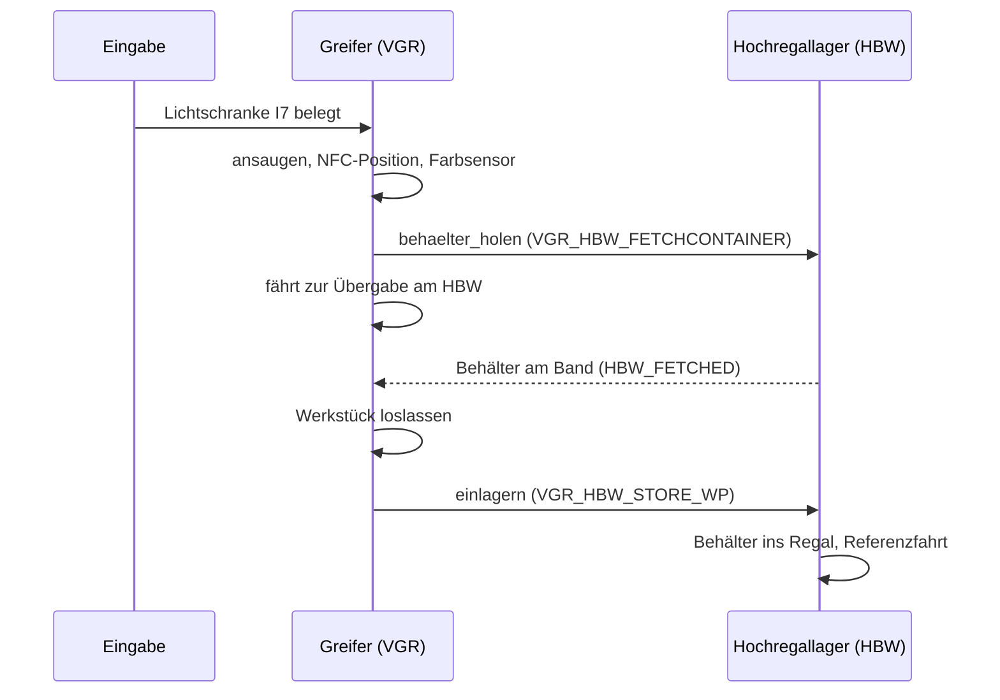
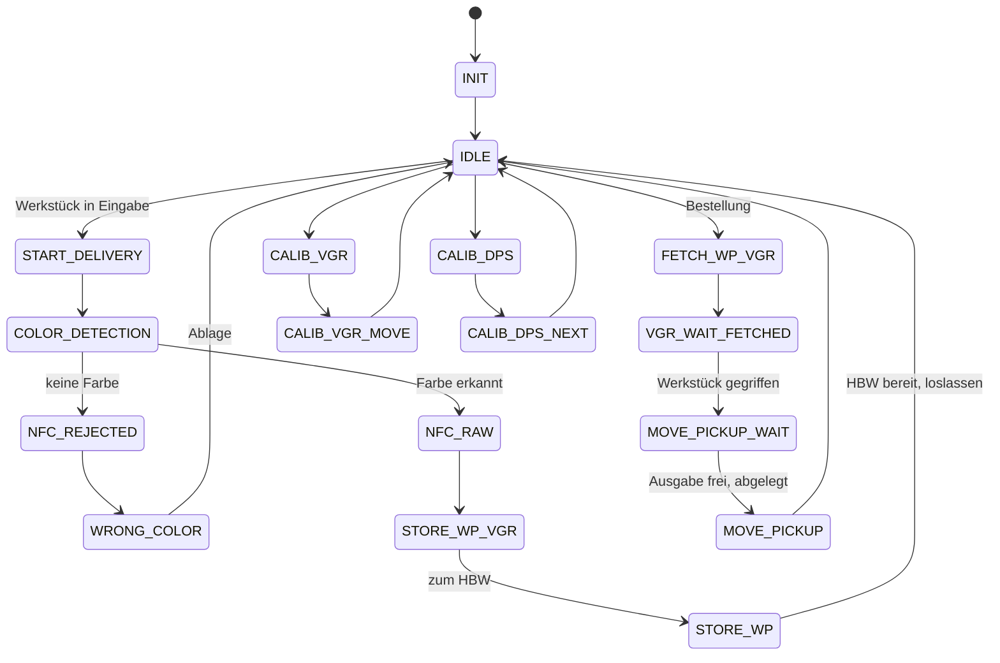
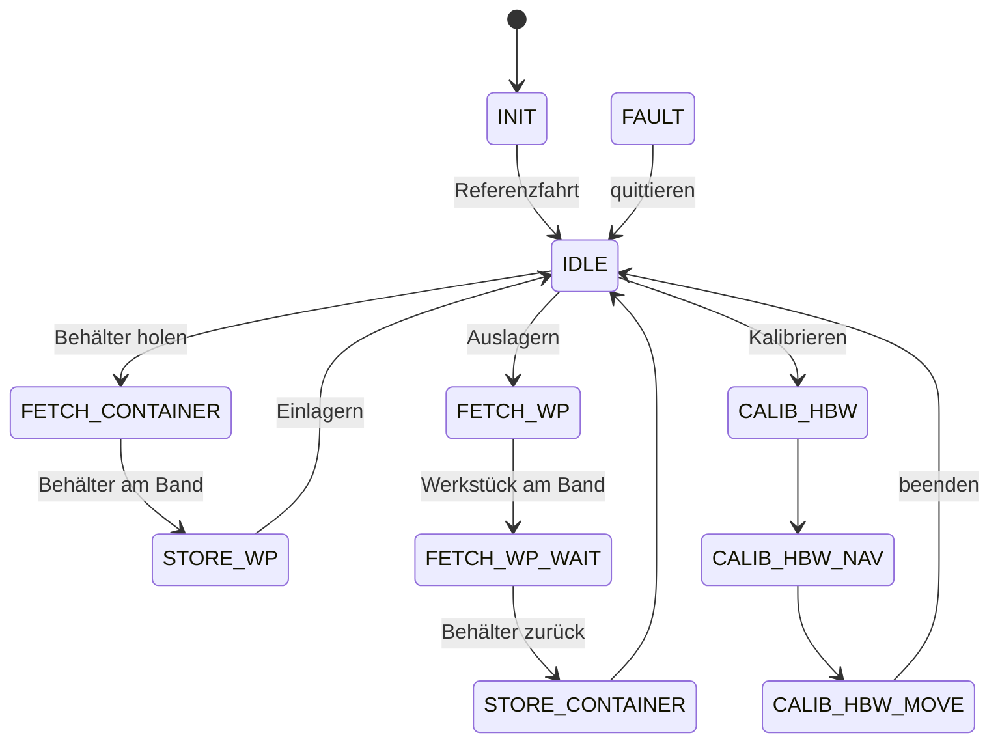

# Hochregallager und Dashboard

Python-Steuerung für die fischertechnik Lernfabrik 4.0 mit Dashboard im Browser. Unterstützt werden zwei Stationen:

- **Hochregallager (HBW)**, TXT 192.168.0.12
- **Vakuum-Sauggreifer mit Ein-/Ausgabestation (VGR/DPS)**, TXT 192.168.0.13

Die Logik ist 1:1 aus dem Original-C++-Code übernommen ([fischertechnik/txt_training_factory](https://github.com/fischertechnik/txt_training_factory), `TxtSmartFactoryLib`).
Der Mac steuert beide TXT-Controller per WLAN über [ftrobopy](https://github.com/ftrobopy/ftrobopy).

```
python3 start.py              # Hochregallager + Greifer
python3 start.py --nur-hbw    # nur das Hochregallager
python3 start.py --sim        # ohne Anlage (Simulation)
```

Das Dashboard öffnet sich automatisch unter http://127.0.0.1:8000.

---

## 1. Vorbereitung (einmalig)

1. **Python-Paket installieren:** `pip3 install ftrobopy`
   (`paho-mqtt` brauchst du nur für `--mqtt`.)
2. **Netzwerk:** Den Mac mit dem WLAN des Lernfabrik-Routers verbinden.
   Prüfen mit `ping 192.168.0.12` (Hochregallager) und `ping 192.168.0.13` (Greifer).
   Andere IPs gibst du mit `--ip` bzw. `--ip-greifer` an oder trägst sie in `hochregallager/konfiguration.py` ein.
3. **Original-Programme stoppen:** Auf **beiden** TXT das laufende Programm (`TxtFactoryHBW` bzw. `TxtFactoryVGR`) beenden und *Einstellungen → Autoload* ausschalten. Danach die TXT neu starten.
4. **Kalibrierwerte (optional):** Die Original-Dateien vom TXT funktionieren im selben Format.
   Lege sie dafür in den Ordner `daten/`:

   | Original auf dem TXT | Datei in `daten/` |
   |---|---|
   | `Data/Calib.HBW.json` | `kalibrierung.json` |
   | `Data/Calib.VGR.json` | `kalibrierung_greifer.json` |
   | `Data/Calib.DPS.json` | `kalibrierung_farbsensor.json` |

## 2. Hardwaretest – vor dem ersten Start

```
python3 hardwaretest.py                    # Hochregallager
python3 hardwaretest.py --station greifer  # Greifer + Ein-/Ausgabe
```

| Greifer-Anschluss | Funktion | erwarteter Wert |
|---|---|---|
| I1 / I2 / I3 | Referenztaster Drehung / Höhe / Arm | 1 = gedrückt |
| M1+C1 / M2+C2 / M3+C3 | Motor + Encoder Drehung / Höhe / Arm | Position ≈ 100 nach Test |
| O7 / O8 | Kompressor / Ventil | Sauger saugt an |
| I7 | Lichtschranke Eingabe | **0** = Werkstück liegt drin |
| I8 | Farbsensor (analog) | weiß < rot < blau (mV) |
| C4 | Lichtschranke Ausgabe | **1** = frei |

Beim Greifer immer **zuerst die Höhe** (Test 2) referenzieren, damit der Arm oben ist, bevor er sich dreht.
Fährt etwas in die falsche Richtung, sofort **Strg+C** drücken.

## 3. Bedienung im Dashboard

Der Reiter **Übersicht** ist für den Automatikbetrieb mit Greifer und Hochregallager gedacht:

- **Einlagern:** Werkstück in die Eingabe legen. Der Greifer erkennt es (Lichtschranke I7) und saugt es an. Dann fährt er zum Farbsensor und bestimmt die Farbe. In der Zwischenzeit stellt das Hochregallager einen leeren Behälter aufs Band. Der Greifer legt das Werkstück hinein, danach lagert das Hochregallager den Behälter ein.
  Wird keine Farbe erkannt, landet das Werkstück in der Ablage für falsche Werkstücke.
  Die automatische Annahme lässt sich abschalten. Dann startest du den Vorgang mit *Jetzt annehmen*.
- **Bestellen:** Farbe wählen. Das Hochregallager lagert den Behälter aus, der Greifer nimmt das Werkstück heraus und legt es in die Ausgabe. Danach geht der leere Behälter zurück ins Regal. Ist die Ausgabe belegt (C4), wartet der Greifer, bis sie frei ist.
- **NOT-HALT** stoppt beide Stationen. Danach jede Station einzeln quittieren.

Der Reiter **Hochregallager** enthält die Handsteuerung, die Kalibrierung und den Handbetrieb des Regals (wie bisher). Solange der Greifer gerade mit dem Hochregallager arbeitet, sind diese Knöpfe gesperrt.

Der Reiter **Greifer** enthält:
- Achspositionen und Eingänge
- Handbetrieb: Achsen verfahren, gespeicherte Punkte anfahren, Sauger an/aus
- **Positionen kalibrieren:** Punkt wählen (Eingabe, Farbsensor, NFC, Ablage, Ausgabe, Hochregallager …). Der Greifer fährt ihn an. Dann mit den ±-Knöpfen justieren und *Position speichern*. Die Anfahrpunkte „…0“ werden dabei wie im Original mit angepasst.
- **Farbsensor kalibrieren:** Nacheinander ein weißes, rotes und blaues Werkstück unter den Sensor legen und jeweils *messen* drücken. Die Schwellwerte werden wie im Original als Mittelwerte berechnet.

In der Simulation (`--sim`) gibt es zusätzlich Knöpfe, mit denen man Werkstücke in die Eingabe legen und die Ausgabe belegen kann.

## 4. Aufbau des Codes

| Python | entspricht im C++-Original | Inhalt |
|---|---|---|
| `hochregallager/konfiguration.py` | Konstruktoren, `PinAssignmentTXT.md`, `saveDefault()` | IPs, Pin-Belegung, Standardpositionen |
| `hochregallager/hardware.py` | Transferbereich `FISH_X1_TRANSFER` | Motoren/Ausgänge/Zähler/Eingänge (ftrobopy) + Simulation |
| `hochregallager/achsen.py` | `TxtAxis1RefSwitch`, `TxtAxisNSwitch`, `TxtConveyorBelt` | Referenzfahrt, Positionieren, Ausleger, Band |
| `hochregallager/station.py` | `TxtSimulationModel` | gemeinsame Grundlage: Status, Not-Halt, Hauptschleife |
| `hochregallager/steuerung.py` | `TxtHighBayWarehouse*.cpp` | Hochregallager: Abläufe + Zustandsautomat |
| `hochregallager/greifer.py` | `TxtVacuumGripperRobot*.cpp`, `TxtVacuumGripper`, `TxtDeliveryPickupStation` | Greifer + Ein-/Ausgabe: Abläufe + Zustandsautomat |
| `hochregallager/daten.py` | `…CalibData`, `…Storage` | Lager, Kalibrierungen (Original-JSON-Format) |
| `hochregallager/mqtt_bruecke.py` | `TxtMqttFactoryClient` | optional: HBW mit Original-Greifer per MQTT |
| `hochregallager/dashboard.py/.html` | – (neu) | Dashboard |

### Zusammenspiel Greifer ↔ Hochregallager

Im Original sprechen die beiden Stationen über MQTT miteinander (`fl/vgr/do`, `fl/hbw/ack`). Hier laufen beide im selben Programm. Der Greifer ruft dieselben Befehle direkt beim Hochregallager auf:



### Zustandsautomat Greifer (aus `TxtVacuumGripperRobotRun.cpp`)



### Zustandsautomat Hochregallager (aus `TxtHighBayWarehouseRun.cpp`)



## 5. Unterschiede zum Original

- **Kein NFC:** Die NFC-Position wird wie im Original angefahren, gelesen oder beschrieben wird aber nichts. Jedes Werkstück bekommt stattdessen eine erzeugte ID.
- **Auslagern direkt in die Ausgabe:** Im Original fährt das Werkstück vorher über Bearbeitungsstation und Sortierstrecke. Das kommt dazu, sobald diese Stationen in Python laufen. Die Positionen dafür (MPO, SSD) sind schon kalibrierbar.
- **Fehlerbehandlung:** Statt `exit(1)` gehen die Stationen in den Zustand FAULT und lassen sich quittieren. Meldet das Hochregallager während einer Übergabe einen Fehler, bricht auch der Greifer ab, statt endlos zu warten.
- **Eingabe-Entprellung:** Ein Werkstück wird erst angenommen, wenn die Lichtschranke 0,5 s belegt ist. Außerdem muss das Hochregallager bereit sein und einen leeren Behälter haben.
- **Bedienung:** Dashboard statt Joystick und NFC-Befehlskarten. Not-Halt und Handbetrieb sind neu. Töne werden nicht abgespielt.

## 6. Bitte an der Anlage prüfen

- Die Standardpositionen des Greifers stammen aus dem Original. Vor dem ersten Automatiklauf die Punkte **Eingabe, Farbsensor, Ablage, Ausgabe und Hochregallager** im Dashboard anfahren und bei Bedarf nachkalibrieren.
- Den Farbsensor einmal mit euren Werkstücken kalibrieren. Licht und Abstand beeinflussen die Messwerte.
- Die Tastersignale kommen per WLAN mit etwa 10–50 ms Verzögerung an. Fährt eine Achse spürbar über den Taster hinaus, `GESCHWINDIGKEIT` in `konfiguration.py` senken.
