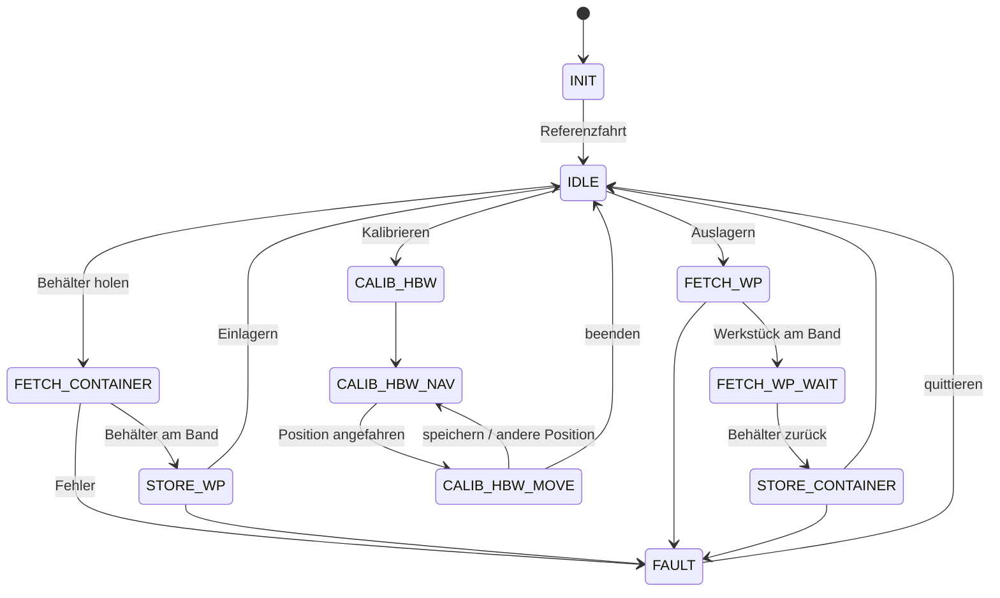

# Hochregallager und Dashboard

Python-Steuerung für das **Hochregallager (HBW)** der fischertechnik Lernfabrik 4.0, mit einem Test-Dashboard im Browser.
Die Logik ist 1:1 aus dem Original-C++-Code ([fischertechnik/txt_training_factory](https://github.com/fischertechnik/txt_training_factory), `TxtSmartFactoryLib`) übernommen.
Der Mac steuert den TXT-Controller des Hochregallagers per WLAN über [ftrobopy](https://github.com/ftrobopy/ftrobopy).

```
python3 start.py          # an der Anlage
python3 start.py --sim    # ohne Anlage (Simulation)
```

Das Dashboard öffnet sich automatisch unter http://127.0.0.1:8000.

---

## 1. Vorbereitung (einmalig)

1. **Python-Pakete installieren**
   ```
   pip3 install ftrobopy
   ```
   (`paho-mqtt` brauchst du nur, wenn du mit `--mqtt` die restliche Lernfabrik anbinden willst.)

2. **Netzwerk:** Verbinde den Mac mit dem WLAN des TP-Link-Routers der Lernfabrik.
   Der HBW-TXT hat dort die feste IP **192.168.0.12** (laut `doc/Network_Config.md` im Original-Repo).
   Prüfen: `ping 192.168.0.12`. Hat euer TXT eine andere IP, startest du mit `python3 start.py --ip <IP>` oder trägst sie in `hochregallager/konfiguration.py` ein.

3. **Original-Programm auf dem HBW-TXT stoppen.** ftrobopy funktioniert nur, wenn auf dem TXT kein anderes Programm läuft.
   Am Display des HBW-TXT das laufende Programm `TxtFactoryHBW` beenden und unter *Einstellungen → Autoload* den automatischen Start ausschalten.
   Danach den TXT neu starten.

4. **Kalibrierwerte übernehmen (optional, aber empfohlen).** Das Original speichert die Positionen auf dem TXT in `Data/Calib.HBW.json`.
   Kommt ihr an die Datei heran, legt ihr sie als `daten/kalibrierung.json` in diesen Ordner. Das Format ist identisch.
   Ohne Datei werden die Standardwerte aus dem Original benutzt. Die könnt ihr im Dashboard nachkalibrieren (siehe unten).

## 2. Hardwaretest – vor dem ersten Start

```
python3 hardwaretest.py
```

Damit prüfst du Schritt für Schritt, ob alles so angeschlossen ist wie erwartet:

| Anschluss | Funktion | Test |
|---|---|---|
| I5 | Referenztaster X (horizontal) | 1 (Taster von Hand drücken) |
| I8 | Referenztaster Y (vertikal) | 1 |
| I6 / I7 | Ausleger eingefahren / ausgefahren | 1, 2 |
| I1 / I4 | Lichtschranke außen / innen am Band | 1 |
| M2 + C2 | Motor + Encoder X | 4 |
| M4 + C4 | Motor + Encoder Y | 5 |
| M3 | Motor Ausleger | 2 |
| M1 | Motor Förderband | 6, 7 |

Ein gedrückter Taster muss als **1** angezeigt werden. Fährt ein Motor in die falsche Richtung, sofort **Strg+C** drücken.

## 3. Bedienung im Dashboard

**Einlagern** (im Original übernimmt der Sauggreifer die Schritte zwischen 1 und 2):
1. *Leeren Behälter holen*: Der erste leere Behälter wird aus dem Regal aufs Band gestellt.
2. Werkstück in den Behälter legen, Farbe wählen, *Einlagern* drücken. Der Behälter kommt zurück auf seinen Platz, danach folgt eine Referenzfahrt.

**Auslagern:**
1. Farbe wählen, *Auslagern* drücken. Der Behälter mit dem Werkstück kommt aufs Band.
2. Werkstück entnehmen, *Leeren Behälter zurück* drücken.

**Weitere Funktionen:**
- **NOT-HALT** schaltet sofort alle Motoren aus. Danach *Fehler quittieren* drücken, es folgt eine Referenzfahrt.
- **Lagerplatz korrigieren:** Klick auf ein Fach (im Zustand IDLE oder FAULT), wenn die Software-Belegung nicht zum echten Regal passt.
- **Handbetrieb** (nur im Zustand IDLE): Achsen schrittweise verfahren, Ausleger und Band einzeln bewegen, Fächer anfahren.
- **Kalibrieren:** Position wählen (Band, A1, B2, C3), mit ±-Knöpfen genau vor das Fach fahren, *Position speichern*.
  A1 legt Spalte 1 und Zeile A fest, B2 Spalte 2 und Zeile B, C3 Spalte 3 und Zeile C.
  Gespeichert wird in `daten/kalibrierung.json`.

Der Lagerbestand liegt in `daten/lager.json` und bleibt beim Neustart erhalten.

Zum Beenden **Strg+C** im Terminal drücken. Dabei werden alle Motoren ausgeschaltet.

## 4. Aufbau des Codes

| Python | entspricht im C++-Original | Inhalt |
|---|---|---|
| `hochregallager/konfiguration.py` | Konstruktor `TxtHighBayWarehouse.cpp`, `PinAssignmentTXT.md` | IP, Pin-Belegung, Geschwindigkeiten, Timeouts |
| `hochregallager/hardware.py` | Transferbereich `FISH_X1_TRANSFER` | Zugriff auf Motoren/Zähler/Eingänge (ftrobopy) + Simulation |
| `hochregallager/achsen.py` | `TxtAxis1RefSwitch`, `TxtAxisNSwitch`, `TxtConveyorBelt` | Referenzfahrt, Positionieren mit Encoder, Ausleger, Band |
| `hochregallager/daten.py` | `TxtHighBayWarehouseStorage`, `…CalibData` | Lagerbelegung, Kalibrierung (gleiches JSON-Format) |
| `hochregallager/steuerung.py` | `TxtHighBayWarehouse.cpp`, `…Run.cpp` | Bewegungsabläufe + Zustandsautomat |
| `hochregallager/mqtt_bruecke.py` | `TxtMqttFactoryClient`, `TxtFactoryClient/main.cpp` | optionale Anbindung an Sauggreifer/Lernfabrik-Dashboard |
| `hochregallager/dashboard.py/.html` | – (neu) | Test-Dashboard |
| `start.py`, `hardwaretest.py` | `main()` | Programmstart, Hardwaretest |

### Zustandsautomat (aus `TxtHighBayWarehouseRun.cpp`)



Bei jedem Eintritt in IDLE fährt die Anlage eine Referenzfahrt. Das ist im Original genauso.

### Bewegungsablauf beim Einlagern (Beispiel)

1. `behaelter_holen`: Ausleger einfahren, X/Y gleichzeitig vor das Fach, Ausleger ausfahren, Y um 40 anheben, Ausleger einfahren, zum Band, Ausleger ausfahren, Y um 40 absenken, Band 1,2 s raus. Der Ausleger bleibt ausgefahren.
2. `einlagern`: Band 1,0 s rein, Y um 40 anheben, Ausleger einfahren, vor das Fach (40 höher), Ausleger ausfahren, absenken, Ausleger einfahren, Referenzfahrt.

## 5. Unterschiede zum Original

- **Fehlerbehandlung:** Das Original beendet bei einem Achsfehler (Timeout, Endlage) das ganze Programm mit `exit(1)`. Hier geht die Anlage in den Zustand FAULT und kann quittiert werden.
- **Bedienung:** Im Original kommen die Aufträge per MQTT vom Sauggreifer und die Kalibrierung läuft über den Joystick. Hier geht beides über das Dashboard. Mit `--mqtt` funktionieren zusätzlich die Original-Topics (`fl/vgr/do`, `fl/hbw/ack`, `f/i/stock`, `f/i/state/hbw`).
- **Not-Halt und Handbetrieb** sind neu.
- **Töne** des TXT (Fehler-/Infoton) werden nicht abgespielt.

## 6. Bekannte Grenzen / bitte an der Anlage prüfen

- Die Übertragung per WLAN verzögert Tastersignale um etwa 10–50 ms. Bei den Referenzfahrten ist das unkritisch. Sollte eine Achse spürbar über den Taster hinausfahren, `GESCHWINDIGKEIT` in `konfiguration.py` senken.
- Das genaue Anhalten nach Encoder-Impulsen übernimmt der TXT selbst (Streckenbefehl), wie im Original.
- Die Standard-Kalibrierwerte stammen aus dem Original-Code. Eure Anlage kann davon abweichen, deshalb vor dem ersten Ein-/Auslagern einmal kalibrieren oder die Werte mit dem Handbetrieb prüfen.
